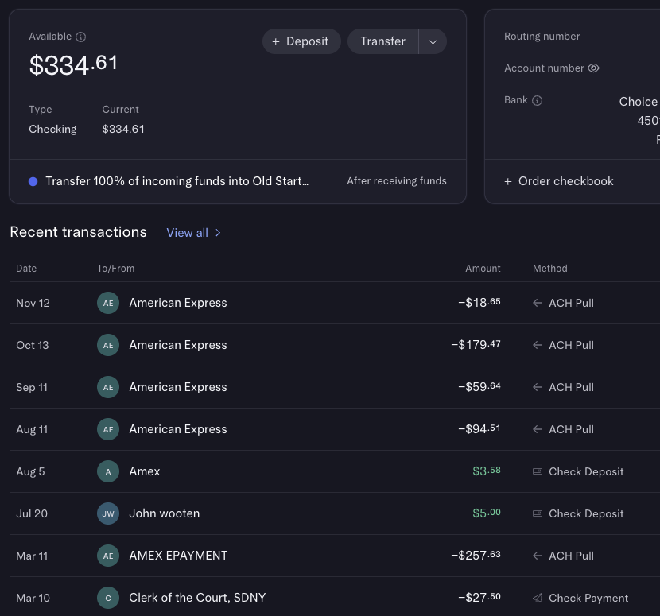

```
title: Collection Appeal Request, Box 15 — Additional Pages
means: via Document Upload Tool
date: 26 Nov 2026
addressee: |
  Department of the Treasury
  Internal Revenue Service
  Attn: Collection Appeals Program
  Ogden, UT 84201-0038
```

## Relief sought and scope of appeal

The taxpayer requests review of the appropriateness of a proposed or actual levy. It requests that the Service refrain from proceeding with the levy, where doing so would better preserve its ability to meet its obligations and satisfy any properly determined federal tax liability.

This appeal has an independent basis even if the Service ultimately sustains the underlying assessment. It concerns the timing, manner, and consequences of the collection action rather than a request that Appeals redetermine the penalty through CAP. The taxpayer separately disputes the 2025 Form 1120-S late-filing penalty in its November 13 response to Letter 1382C.[^response-1382c] That dispute and all independently available review rights are expressly reserved; nothing in this appeal concedes the validity or amount of the assessment.

## Collection while the Service is considering the taxpayer's submissions

The taxpayer submitted a claim for abatement after receiving Notice CP162A in late June 2026. It contacted the Service on July 15, 2026, and subsequently received Letter 1382C, dated October 14, requesting evidence of the postmark of the corporation's return. The taxpayer supplied its detailed response dated November 13, addressing the mailing circumstances, the conflicting receipt dates and shareholder-count information, and reasonable cause under 26 USC 6699(a).

The taxpayer also recalls receiving differing representations from the Service concerning 60-day and 90-day periods. The ensuing collection action is difficult to reconcile with the expectation that its pending submission would receive meaningful consideration. A taxpayer who is asked to supply supporting materials should be able to ascertain whether the Service is still reviewing those materials and whether collection may proceed in the meantime.

The taxpayer requests that Appeals examine the applicable correspondence, account history, collection holds, and telephone-contact records to determine:

- What the 60-day and 90-day periods referred to, when each period began, and what the Service communicated about collection during those periods;
- Whether a collection hold was requested, entered, extended, removed, or allowed to expire, and the date and reason for any such action;
- Whether the collection office considered the pending abatement request and the November 13 response before deciding to proceed;
- Whether the Service complied with the applicable notice, managerial-review, and collection procedures for the particular levy.

## Independent grounds for opposing the levy

The proposed means of collection poses a distinct threat to the taxpayer's ability to meet ordinary corporate obligations as they become due. Even if the assessment were correct, depriving the corporation of operating cash could cause costs substantially out of proportion to the immediate benefit of collection.

### Renewal of valuable domain names

Domain registrations must be renewed on their own deadlines. Domains used for websites, communications, and corporate records are not merely discretionary purchases: they preserve access to established organizational resources. Failure to renew a domain can lead to interruption of service, redemption charges, or permanent loss of the registration. The cost of recovering or replacing it may be substantially greater than the renewal fee, and replacement cannot necessarily restore existing links or communications.

The taxpayer's financial statements document at least $2,250 in long-term, illiquid web-domain assets (https://wooten.link/_4#9).[^2025-return-assets] Maintaining those assets requires timely renewal payments. The following page reports $556.53 in annual web-domain expenses (https://wooten.link/_4#10),[^2025-domain-expenses] equivalent to an average monthly expense of $46.38 ($556.53 ÷ 12 = $46.3775, rounded to the nearest cent), independently of other operating expenses.

The operating bank account statement below shows a balance of approximately $334.[^bank-account-balance] The disputed $510 penalty exceeds the balance shown. A levy that takes the available balance would leave no cash in that account to pay domain renewal charges as they come due.



A collection action that deprives the taxpayer of the cash needed to pay those renewals risks the permanent loss of significant corporate assets. The documented value of the domain portfolio is not itself available operating cash. Preserving sufficient liquidity to renew the registrations would protect existing corporate value and resources from which the taxpayer may ultimately satisfy its obligations. The taxpayer requests that the amount and timing of upcoming renewal charges be considered in assessing the appropriateness of the levy.

### Timely payment of franchise taxes and other corporate obligations

State franchise taxes and other corporate compliance charges have fixed deadlines. Inability to pay on time can trigger additional fees, interest, or administrative expense. The consequence of diverting cash from these obligations is not necessarily a reduction in the taxpayer's aggregate liabilities: it can instead create new liabilities to other authorities and diminish the cash available for future federal payments.

This concern reflects the taxpayer's actual experience. In a prior year, a franchise-tax obligation was paid late, increasing the total cost of meeting that obligation by $200. The taxpayer's 2025 Statement of Profit, Loss, and Retained Earnings, https://wooten.link/_4#10[^2025-taxes-and-licenses] includes this in the $430.63 in Taxes and Licenses, alongiside $556.53 in Web Domains. These figures establish the reported categories of recurring corporate expenditure.

The prior delay illustrates why payment timing matters independently of the merits of the federal assessment.

## Financial ability to pay

The taxpayer has received no revenue to date in 2026.

The taxpayer's 2025 Form 1120-S Tax Return Transcript, dated October 26, 2026 (http://wooten.link/_1, pp. 1–2), reports no gross receipts, $1,000 in other income, $1,696 in total deductions, and an ordinary loss of $696 for the tax year. The return reports $17,505 in total assets at year-end, but the value of those assets does not establish the amount of cash available to pay the disputed $510 penalty. Page 9 of the taxpayer's 2025 return (https://wooten.link/_4#9)[^2025-return-assets] reports noncash assets with a total fair market value of $16,496.49: $14,230.21 in Stellar Lumens (XLM), $2,250 in the blocktransfer.com domain, and $16.28 in FxDAO tokens. Stellar Lumens alone account for approximately 81% of the $17,505 in total year-end assets reported in the transcript. The taxpayer holds its Stellar Lumens as a long-term capital investment, rather than as cash available for ordinary corporate expenses. Its domain asset likewise is not equivalent to unrestricted operating cash.

Although the taxpayer may be able to sell some of its Stellar Lumens, doing so solely to pay the disputed penalty at presently unfavorable market prices would, in the taxpayer's judgment, sacrifice the value of a long-term investment to satisfy an immediate collection demand. The taxpayer asks Appeals to consider the net proceeds actually obtainable from a sale, the resulting economic cost, and whether requiring liquidation now would unnecessarily impair its ability to meet its future obligations, including any federal liability ultimately determined to be due.

The taxpayer requests that Appeals determine whether it can pay the disputed assessment in full at this time without impairing its ability to meet necessary obligations and whether collecting the entire amount immediately would make eventual collection more difficult. Where the evidence supports it, the taxpayer requests that sufficient operating funds be preserved. This request does not seek a permanent exemption from collection or concede the validity or amount of the underlying assessment.

## Applicable collection standards

### Scope of CAP review

Under IRM 8.24.1.2 and 8.24.1.3.8,[^irm-cap-review] Appeals must consider whether the proposed or existing levy is appropriate in light of the applicable law, regulations, policy, procedures, and the facts of this case. The taxpayer asks Appeals to consider whether taking money from its operating account now would undermine the Service's ability to collect the liability later, and to direct corrective action if the levy is inappropriate.

The taxpayer recognizes that CAP does not provide a general forum to negotiate alternative collection arrangements or determine the underlying liability. Any separate installment agreement or other collection alternative would be a matter for Collection under the relevant procedures. The availability of such arrangements may be relevant to the appropriateness of the action under review, but the relief sought here concerns the levy itself.

### Release to facilitate collection

Under 26 USC 6343(a)(1)(B)[^usc-levy-release] and 26 CFR 301.6343-1(b)(2),[^cfr-levy-release] the Service must release all or part of a levy if it determines that doing so will help it collect the tax liability, rather than make eventual payment more difficult.

This provision supplies a collection-oriented basis for relief separate from the individual economic-hardship provision in 26 USC 6343(a)(1)(D). The taxpayer is a corporation and does not claim entitlement to relief under the reasonable-basic-living-expenses standard in 26 CFR 301.6343-1(b)(4)(i). Instead, it requests consideration of whether a full or partial release would facilitate collection by preventing otherwise avoidable costs and preserving the resources needed for compliance and payment.

For a levy that has not yet been served, the same practical considerations support reviewing its appropriateness before it is imposed. For an existing levy, the taxpayer requests a determination under the applicable release provisions. It acknowledges that the required showing must be made on actual financial evidence.

## Preservation of the status quo pending review

The taxpayer requests prompt confirmation of the status of the CAP request and any applicable collection stay. IRM 5.1.9.4[^irm-cap-collection-stay] contains procedural conditions governing CAP requests in field collection, including circumstances under which collection may resume. The taxpayer requests that the Service identify the procedures applicable to the office handling this case and observe any stay required by those procedures.

If a levy has already been served on a qualifying bank, the taxpayer requests immediate confirmation of the service date, amount held, and anticipated surrender date. IRM 5.11.4[^irm-bank-levy] describes the 21-calendar-day holding period under 26 USC 6332(c). If funds have not yet been surrendered, the taxpayer asks Collection to coordinate with the bank and Appeals promptly regarding any authorized release or extension of the holding period. The holding period is not itself a release, and this appeal is not assumed to extend it automatically.

If funds have already been surrendered, the taxpayer requests identification of the applicable procedure, if any, for challenging the collection or seeking return of the proceeds. It does not assume that CAP or a request for release provides a remedy after remittance.

## Requested determination

For the foregoing reasons, the taxpayer respectfully requests that Appeals:

1. Review the appropriateness of the bank-account levy, including the Service's collection chronology and any applicable restrictions on collection.
2. Consider the actual operational expenses, near-term deadlines, and liquidity evidence in determining whether the levy impairs rather than facilitates ultimate collection.
3. Decline to sustain an inappropriate proposed levy or direct release of an existing levy to the extent authorized and warranted, including partial release if sufficient to address the demonstrated concern.
4. Identify the current status of collection, the basis for the determination, and any corrective action directed, and communicate the result in writing.

If the required Collection managerial review has not yet occurred, the taxpayer requests that it be arranged and, if the matter remains unresolved, that this request and its supporting materials be forwarded to the Independent Office of Appeals under CAP. The taxpayer requests that any requests for additional information be communicated in writing.

The taxpayer remains willing to furnish the relevant documentation and to address any properly established liability through the appropriate procedures. It requests that the Service not impose avoidable additional costs while resolving the disputed account.

## Confirmation of updated mailing address

The taxpayer has changed its corporate address, as reflected in its transfer-agent registration filing with the Commission.[^transfer-agent-registration] The updated address is not yet reflected in the taxpayer's IRS account transcript. The taxpayer requests that the Service process its Form 8822-B[^form-8822b] and confirm in writing that its records have been updated and that all subsequent notices and correspondence will be mailed to the new corporate address, so that the taxpayer may receive them and respond within the applicable deadlines. The Commission filing corroborates the address change but does not establish that the Service has processed it.

Respectfully submitted,

BlockTrans Syndicate

[^response-1382c]: Taxpayer's November 13, 2026 response to Letter 1382C, _available at_ https://blocktransfer.org/ref/treasury/4.

[^transfer-agent-registration]: Transfer-agent registration filing with the Commission, _available at_ https://www.sec.gov/Archives/edgar/data/1846058/000184605826000008/xslFTA1X01/primary_doc.xml.

[^form-8822b]: Form 8822-B, Change of Address or Responsible Party — Business, _available at_ https://github.com/blocktransfer/treasury-cases/blob/eb265c6b2eac897f1f18bcc8e64e2fcab396e3d5/case-1/corresp/f8822b.pdf.

[^2025-return-assets]: 2025 Form 1120-S, https://wooten.link/_4#9, fair market value of assets, _available at_ https://wooten.link/_4.

[^2025-domain-expenses]: 2025 Statement of Profit, Loss, and Retained Earnings, https://wooten.link/_4#10, Web Domains, _available at_ https://wooten.link/_4.

[^2025-taxes-and-licenses]: 2025 Statement of Profit, Loss, and Retained Earnings, https://wooten.link/_4#10, Taxes and Licenses and Web Domains, _available at_ https://wooten.link/_4.

[^bank-account-balance]: Taxpayer's operating bank-account screenshot, _available at_ https://github.com/blocktransfer/treasury-cases/blob/fbc62311a81ff0c8052bdc9c6a65bf32d9303dd2/case-1/CAP/statement.png.

[^irm-cap-review]: IRM 8.24.1.2 and 8.24.1.3.8, Collection Appeals Program review, _available at_ https://www.irs.gov/irm/part8/irm_08-024-001.

[^usc-levy-release]: 26 USC 6343(a)(1)(B), release of levy to facilitate collection, _available at_ https://uscode.house.gov/us/usc/119-136/t26/s6343/.

[^cfr-levy-release]: 26 CFR 301.6343-1(b)(2), release of levy to facilitate collection, _available at_ https://www.ecfr.gov/current/title-26/section-301.6343-1.

[^irm-cap-collection-stay]: IRM 5.1.9.4, Collection Appeals Program procedures, _available at_ https://www.irs.gov/irm/part5/irm_05-001-009.

[^irm-bank-levy]: IRM 5.11.4, bank levies and the 21-day holding period, _available at_ https://www.irs.gov/irm/part5/irm_05-011-004.

---

## Working notes — not part of the appeal submission

- The November 13 preliminary appeal identified the 2025 Statement of Profit, Loss, and Retained Earnings at https://wooten.link/_3 as a supporting financial exhibit. Confirm its relationship to the expanded appeal's exhibit at https://wooten.link/_4 before submission.
- Confirm the exact language, dates, source, and subject of the 60-day and 90-day representations; obtain the corresponding letters and collection history. The repository does not establish that either representation was an enforceable promise to suspend collection.
- Confirm the CAP receipt, any managerial conference, collection office, notice identifiers, tax periods covered, whether a levy was actually served, the service date and bank surrender status. The existing file records November 16 as the original filing date; no new filing is represented here.
- Confirm the date of the supplied bank-account screenshot, whether the approximately $334 balance remains current, and whether any additional unrestricted cash is available; obtain dated domain-renewal invoices, franchise-tax due dates and charges, prior late-fee documentation, and any other necessary business expenses. Quantify the minimum cash needed and explain how retaining it facilitates eventual payment. Obtain current holdings, market quotations, acquisition costs, and estimated net liquidation proceeds to substantiate the asserted disadvantage of selling now.
- The figures at https://wooten.link/_4#9 have been confirmed from the supplied excerpt: $14,230.21 in Stellar Lumens, $2,250 in the blocktransfer.com domain, and $16.28 in FxDAO tokens, totaling $16,496.49 in reported fair market value. Confirm the $556.53 in annual web-domain expenses at https://wooten.link/_4#10 before submission; the shortlink could not be independently retrieved during this revision. The monthly expense computation has been checked. Retain dated renewal invoices to substantiate actual upcoming payments.
- Request access to the nonprivileged administrative file where applicable under 26 USC 7803(e)(7) and IRM 8.24.1.3.1, without assuming the statutory advance-access requirements apply to every corporate taxpayer.
- Keep any distinct CDP deadlines and remedies separate; do not assume a CAP request preserves a CDP hearing deadline or confers judicial review.
- Citation correction: *Lindsay Manor Nursing Home, Inc. v. Commissioner*, 148 T.C. No. 9 (2017)[^lindsay-manor-opinion] was vacated on mootness grounds on appeal, No. 17-9002 (10th Cir. Mar. 27, 2018).[^lindsay-manor-vacatur] Do not rely on that vacated decision as precedent. The working appeal instead rests on the current regulation and the separate statutory facilitation-of-collection ground.

[^lindsay-manor-opinion]: *Lindsay Manor Nursing Home, Inc. v. Commissioner*, 148 T.C. No. 9 (2017), vacated, _available at_ https://www.courtlistener.com/opinion/4563370/lindsay-manor-nursing-home-inc-v-commr/.

[^lindsay-manor-vacatur]: *Lindsay Manor Nursing Home, Inc. v. Commissioner*, No. 17-9002 (10th Cir. Mar. 27, 2018), vacatur on mootness grounds, _available at_ https://law.justia.com/cases/federal/appellate-courts/ca10/17-9002/17-9002-2018-03-27.html.
