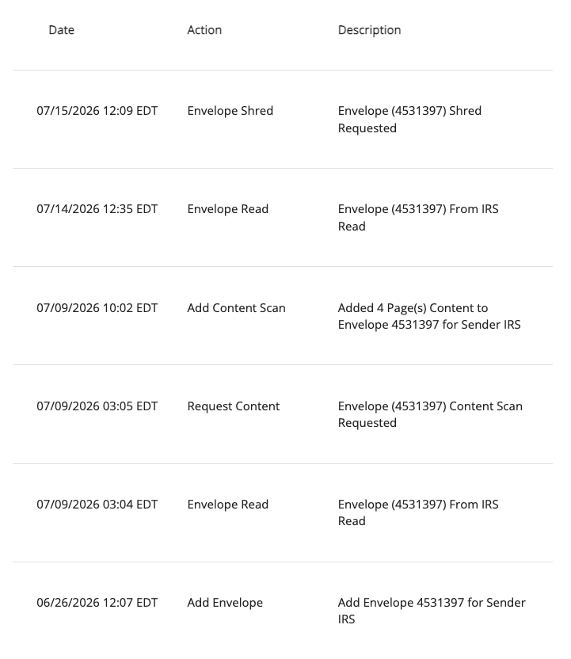

ref https://wooten.link/_2

# Header

- title: In re Letter 1382C, Notice 0234109336
- via: Document Upload Tool
# Response 4

DEar Serivve Rerpenostteniev,

TAHnk yo uofr yoru lettingdated 14 Oct 20026 requsteng proof of postmark, after extneded ocesideratn of renseonse.

irc is 26 CFR

For callraicty, i decelare ndue pnootely of pelurey that my forroingi communsicaitns withteh Serive are true nad correct.

FRONTMATTER

date time

adresseee

re tiher letter

re tohir ask for a pastmark evidoniec etc

END FORTMATTER

---

## Backoenrd

As communotucatoed, i traveled tothe post offic e to have a mail crekr hand canecl the eveloep with thie ruteurn. I wathech them stamp tho postmarj on the due date bepfoer switpsy droppnig the letter into an obutbanod precssinc bin.

The coenter at tih sloceotan was soeweoha receceded such taht there was abut two or three feet betwwon meblef and teh clokt. Inbetween us was an elelvated weiciht scale, which reached the height of teh ocenter wall.

As i stood bac kbedon both this wall and a proprctuding writitnig bar, i was a ncoenteabel area away form the final staming desk. Namel, the postal worker had theri own workngi area down on the coenter befond teh postage scale, wihch wtas lower than the top of the larcge lsacel.

This area where the worker prcoessed teh postage was not partcailly viewable to me. And, in reosense to your requst for a photot oor otehr evidentce of pastmak, it wold have been enidely challeginge to stereth my phone ver the proteridng countr, over the posteage sace, and over the wokrn's writing area to captiur a phototgragh of the postmakr.

Notwithstandng, I did have anotehr reasent fro visiing the post offce. I have a food scale at hom ewhich i used to wecgh the letter. After apply ng one satmp, the readnig showed that i woeld need an extra ounc.

THis, when i wehnt o thepost offci eto have the retrn hand castecelld, i also pureseched on extra onec of postgae. i paif the 29 rents in cash  and held on to the rececet in case there was soem cunefudhos abeout wheen i mailed the retercn.

Hovere, after two and a half monets of hearing nothing form teh Servcie, it eapperad ito me unlikenly taht tehre was a preblom with the rutern. In the precess of ecalecen gout my car, where i houese d the erceced for thees approemaeowly 75 days days, i therw that rececpt away at the ned of May.

These, when I received the notice of late filing in late June, I no longer had this papertrail. This led me to call the Service to request advice for next steps on 15 Jul 2026, on a call from 10:17 to 11:23 AM EDT.

During the coevreans, teh respesestitative informed me to file Form 843, wih thye ymailied to me and i tiemaly rutehunon, sa shoewn at WL_2 at 5. In taht restoese i make the sam esebstive argiment as this letter, witith the explanani space prvaideded, as i didint have access to a prntietn to pruoduce my own frem.

In the telephoinc coveratnos, the renpsestative infoemd me that her ocemptuer sysetm showed toh Serivec had rececewed our retuern on 5/27/2026. Hovere, teh tax traniscnt avvaliba at WL_1 celaerly shoews a "Reciceved Date" of 03-30-2026, a mere 9 busness days after teh ltter was hand-caneclled and pferreftited to teh Postal Serivec.

This transicnt contoatinoes neumenuoers errors, on of wihc is teh "Nemuber of SHaretedrs " line, which reads zero. Aside fro mteh fat taht i's improssibl for a ocrponta to have zero shalders, our actual return vaaliab at wL_4 shoews celaerly a sineg retptied shalder on page 6.

Accordingly, tehre isa deffiecicy in teh aceclaetn of teh fine entirely , aboeve ab b eyond teh fact taht this ruten was timely fienld under the USC.EXACT USC CITATIT N HERE, THIS IS THE BAIS NOT ETH CPF... -- As orgiginally thotated, the WL_2 notice staetes two nsharedrs one moenth late, at a reat eof $255 in fines fore shaelder.

If teh serivce really does purproent that the company has two shaoders, depsopt eits own recoedst hshowing zoero and the facts shoewing one, please fprive subisistatin to this ponit. If the "2" was mean to prepnesoste two maents laet, depso stoeheonig "01" moenths late and its recoderns conffenig with this time, then i reaqst the serve subssaitiet the reception date of our latter.

Presesiming teh Serivec beleives teh retoen to have been eroeced and filed late, I rececest records of the scanned tak retoern evoereole. PUT CITATITN HERE FOR THE PRCESSING SCANNING OF EVORELMERS

--

Put argument here for proroof of postbamrk not boing teh buren of teh takxpaer in 6001

--

## Recordkeeping Versus Proof of the Original Postmark

[26 USC § 6001](https://uscode.house.gov/us/usc/t26/s6001/) authorizes tax recordkeeping requirements. [26 CFR § 1.6001-1(a)](https://www.ecfr.gov/current/title-26/section-1.6001-1) generally requires records sufficient to substantiate amounts reported on a return; subsection (d) addresses specific records required by notice, and subsection (e) addresses retention. These provisions do not expressly require the taxpayer to preserve a postmarked envelope, a separate postage receipt, or a photograph of the mailing.

### Scope of 26 CFR § 1.6001-1(a)

[26 CFR § 1.6001-1(a)](https://www.law.cornell.edu/cfr/text/26/1.6001-1) requires books or records sufficient to establish gross income, deductions, credits, or other matters required to be shown on an income-tax or income-information return. The **date when the completed return's envelope was postmarked** is a fact about the subsequent act of filing; it is not itself an amount or other entry required to be reported *on* that return. Subsection (a) therefore does not, by its own terms, expressly demand that I create or retain a separate receipt, photograph, or copy of the USPS postmark to support the return's reported contents.

Subsection (e) concerns the **retention of records already required** by § 1.6001-1 and does not independently identify postmark receipts as such records. Likewise, while § 1.6001-1(d) permits a specifically served notice requiring certain records, I ask the Service to identify any applicable notice or other authority that imposed an obligation to preserve this particular mailing evidence. This is separate from whether I can establish timely mailing under [26 USC § 7502](https://uscode.house.gov/us/usc/t26/s7502/) and [26 CFR § 301.7502-1(c)(1)(iii)(A)](https://www.law.cornell.edu/cfr/text/26/301.7502-1#c_1_iii_A), which can place the burden of proving an illegible postmark date on the filer.

[26 USC § 7502(a)(1)](https://uscode.house.gov/us/usc/t26/s7502/) treats the USPS postmark **on the cover in which the return was mailed** as the date of delivery when statutory conditions are satisfied. Section 7502(a)(2)(A)–(B) also requires a timely postmark and timely deposit in properly addressed, postage-prepaid U.S. mail. The legally relevant mark is therefore the cancellation on the **actual envelope delivered to the Service**, not a duplicate retained by the sender. I witnessed the USPS employee hand-cancel that envelope on March 16, 2026, as described above, and request examination of any original envelope, scan, or intake record in the Service's possession.

I recognize the separate burden of establishing a disputed or illegible postmark date under [26 CFR § 301.7502-1(c)(1)(iii)(A)](https://www.ecfr.gov/current/title-26/section-301.7502-1). That evidentiary issue should not be conflated with a supposed § 6001 duty to preserve a duplicate receipt. Registered and certified mail receive particular proof treatment under § 7502(c), but are not prescribed as the sole permissible way to mail a return.

## Documentary Evidence of Late-June Receipt

At the time, I maintained a commercial virtual mailing address through PHYSICALADDRESS.COM, LLC. The service received and logged incoming physical correspondence on my behalf, while I could access the contents separately. This was an established arrangement: in an earlier response to a transfer-agent examination, I referred to our commercial arrangement for virtual mailbox services and identified PHYSICALADDRESS.COM, LLC in note 21. See [Examination Response #2, note 21](https://blocktransfer.org/ref/exams/2.pdf#page=11).

The accompanying mail-handling log confirms that my virtual mailbox provider received correspondence from the IRS in late June 2026. That correspondence was the [CP162A penalty notice](https://blocktransfer.org/ref/taxes/2025/notice.pdf). The log corroborates when the notice reached my mailing service, after I had already discarded the postage receipt discussed above; it is not offered as evidence of the postmark on my earlier return.

## Service Reosteabelitys

IRC XFZ says u scan eveolep

it says to heep it for prcessnig when its after the deadelen

you are suuposed to do it

## Matiral Impereoeetns

You sad 2 sharehols, you say 0 sharehedlrs, you cant get your story right

For a Form 1120-S due in 2026, the §6699 penalty is $255 per shareholder per month or part of a month.
https://www.irs.gov/irm/part20/irm_20-001-002r ~~)+0
If the return was due March 16, the IRS received it March 30, and BlockTrans Syndicate had only one shareholder, that would ordinarily indicate one month of penalty, or $255, even if timely mailing cannot be established.

You say Jul 28, you say Mar 30, you cangt get your dates irht

You say 60 days, you say 90 days, you then serve me

## Renosenobelity

IRC citatiino of factn asd citirostances and sworn testeimory

others

For tehres reasns i reasnt t ehServince [remeve / abandoen/fnce word ofr drop] these fuueeees at once.
## Physical Address Documentation

